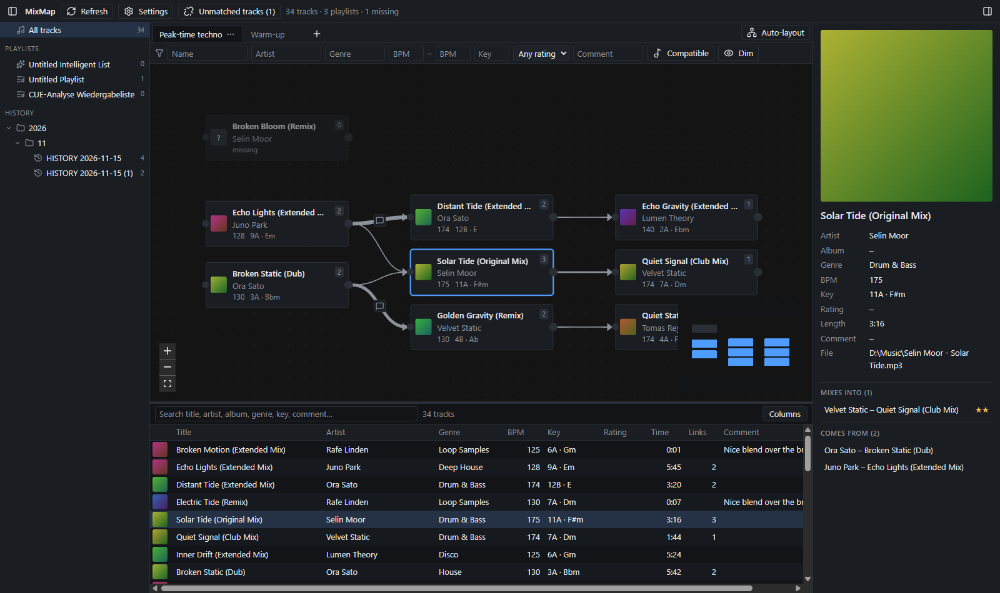

> [!WARNING]
> **100% vibe coded, use at your own risk.**

<p align="center">
  
</p>

<h1 align="center">mixmap</h1>

<p align="center">A transition map for rekordbox DJs.</p>

mixmap reads your local rekordbox library, lets you link tracks into a directed graph of transitions ("A mixes into B"), and shows the linked tracks for whatever is loaded on your decks in a small always-on-top overlay.



<sub>Track names, artists and artwork in the screenshot are anonymized.</sub>

## Features

- **Reads rekordbox 7 directly**: opens the encrypted `master.db` strictly read-only (or a rekordbox XML export), reloads automatically when it changes. mixmap never writes to rekordbox.
- **Transition graph**: drag tracks onto a canvas and link them; each link can have a comment, a 1–5 rating and tags. Auto-layout, minimap, undo.
- **Boards**: separate canvases ("Peak-time techno", "Warm-up", …) sharing the same global links.
- **Filters**: by name, artist, genre, BPM range, key, rating, comment, or "compatible with selected" (Camelot ±1 / relative key, BPM tolerance, half/double tempo).
- **Path-finding**: shortest transition paths between two tracks over your links.
- **Import pairs** from rekordbox playlists or history: back-to-back tracks become links.
- **Live overlay**: always-on-top, click-through window showing the links for the tracks on your decks (memory reader with calibration wizard, or manual mode). Global hotkey to toggle.
- **Portable across machines**: tracks are matched by artist + title + duration, so links survive different paths and rekordbox IDs.
- **Export / import** as `.mixmap.json` (merge or replace) and **LAN sync** between two mixmap instances (paired with a 6-digit code).
- **Single portable `mixmap.exe`** for Windows with built-in auto-update from GitHub Releases.

## Install

Download `mixmap.exe` from the [latest release](https://github.com/patrick-b6n/mixmap/releases/latest) and run it. It's unsigned, so Windows SmartScreen will warn on first start. Requires Windows 10/11 (WebView2). Data lives in `%APPDATA%\mixmap`.

## Development

Requirements: Rust (stable), Node.js 20+. See [docs/SPEC.md](docs/SPEC.md) for the design.

```bash
cargo run -p devserver        # API on http://127.0.0.1:5174
npm --prefix ui install
npm --prefix ui run dev       # UI on http://localhost:5173 (proxies /api to the devserver)
```

Checks: `cargo test`, `cargo clippy -- -D warnings`, `npm --prefix ui test`, `npm --prefix ui run lint` (oxlint), `npm --prefix ui run format:check` (oxfmt; `format` to fix).

## License

MIT
